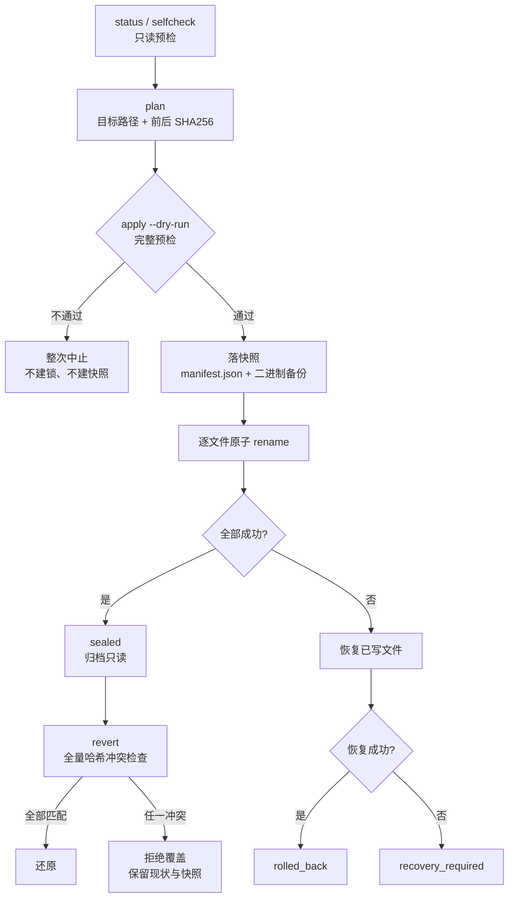

# RuiC DSH Purge

<div align="center">

**让 DSH 真正按你的项目规则办事，而且每一步都能退回。**

DSH 本机维护插件 · 预检 → 快照 → 原子写入 → 冲突检测回滚

[](https://github.com/HRuiCcc/RuiC-dsh-purge/releases/latest)
[](LICENSE)
[](package.json)
[](docs/COMPATIBILITY.md)

基于 [ZiPengWei/dsh-purge](https://github.com/ZiPengWei/dsh-purge) 重写 · MIT · 独立社区项目

</div>

---

## 它是什么

一个跑在你自己机器上的 DSH 插件。DSH 默认把项目里的 `AGENTS.md` 称为"仅供参考、不覆盖系统指令"，也默认走审批与沙箱拦截。RuiC Purge 按需改掉这些默认值——**并且把整个改动做成一次可撤销的事务**：

- **先看清楚**：`status` / `plan` 告诉你当前宿主版本、命中了哪几个目标、改动前后的 SHA256；
- **再动手**：写入前必定落快照，逐文件原子 rename，失败尝试恢复；
- **随时能回去**：`revert` 前全量比对哈希，你自己后来改过的文件不会被覆盖；
- **改坏了有据可查**：`prepared / applying / reverting / recovery_required` 每个阶段都留在快照里。

它只改你指定路径下 DSH 包里的少量字符串常量和默认值：不改签名 `app.asar`、不重签名、不自动重启、不联网、不上传任何东西。

## 设计原则

| 原则 | 含义 |
| --- | --- |
| 本机优先 | 逻辑全在本机跑；不碰云端账号，不发提示词和配置出去 |
| 可见 | 每个动作都有状态与证据，不靠"应该生效了吧" |
| 可回滚 | 写入前自动快照；回滚前逐个核对哈希，冲突就拒绝 |
| 不猜 | 锚点必须精确匹配；版本号相同也要匹配上才算兼容 |
| 不越界 | 不递归扫描家目录、不接管其他 Purge 的备份、不自动卸载插件 |

## 它到底改了什么

一共 8 条补丁，分两层。**新版 DSH 只打其中 4 条**，剩下 4 条交回 DSH 自己的权限机制。

| # | 层 | 补丁 | 改什么 | 旧版布局 | 新版 0.2+ |
| --- | --- | --- | --- | --- | --- |
| 1 | 提示词 | `WORKSPACE_CONTEXT_INTRO` | "仅供参考"→"本次会话强制生效" | 应用 | 应用（常量改名，按新名匹配） |
| 2 | 提示词 | `REPLACEMENT_WORKSPACE_CONTEXT_INTRO` | 同上，替换式基线 | 应用 | 应用（同上） |
| 3 | 提示词 | `SCOPE_INTRO` | 作用域免责→强制措辞 | 应用 | 应用 |
| 4 | 提示词 | `SYSTEM_PROMPT_PERSONA` | persona 追加会话指令 | 应用 | 应用（克制版：照项目约定做完、保留用户改动） |
| 5 | 提示词 | `APPROVAL_NEVER_SENTENCE` | 审批提示句 | 应用 | `native_setting` |
| 6 | 代码 | `SANDBOX_DENY_FILE_WRITE` | 沙箱 `deny file-write*`→`allow` | 应用 | `native_setting` |
| 7 | 代码 | `SANDBOX_MODE_DEFAULT` | 默认模式→`danger-full-access` | 应用 | `native_setting` |
| 8 | 代码 | `APPROVAL_POLICY_DEFAULT` | 默认策略→`never` | 应用 | `native_setting` |

> ⚠️ **旧版布局（< 0.2）8 条全打，其中第 7、8 条会把沙箱默认模式改成 `danger-full-access`、审批策略改成 `never`**——这是全局默认值，影响之后所有会话。只在自己的机器上用，装完先看 `status` 再决定留不留。

### 为什么新版不打权限补丁了

不是偷懒，是实测结论：新版 `never` 策略仍然会拒绝需要审批的请求，光把提示词改成"全权限"改变不了它；而只改 macOS Seatbelt 也同步不了内建文件工具的权限。所以新版改用官方开关：

```text
/permission
/permission danger-full-access
```

`permission.defaultPreset` 管的是**未来会话**的默认值，已恢复的会话可能保留自己的权限——面板会标出这个证据边界，不替你切。

## 为什么是事务，不是脚本

大多数"补丁脚本"是 sed 一下、失败再说。这里把流程当成一次数据库事务：



具体保证：

- **预检即承诺**——锚点缺失、同一锚点出现多次、备份失败，任一发生就不写入；
- **完整替换内容核对**，不用短 marker 判命中（避免假阳性），CRLF 原样保留；
- **进程间锁**避免两个实例同时写同一份宿主文件；
- **回滚是全量的**——只要有一个目标被改过或宿主升级过，整次拒绝，而不是"能还的先还了"；
- **不猜锁过期**——异常退出后锁不会自动失效，需要你确认原进程结束后手动移除。

## 安装

从 [Releases](https://github.com/HRuiCcc/RuiC-dsh-purge/releases/latest) 取 `ruic-dsh-purge-1.0.1.tgz`，在**对应 DSH 实例**的 CLI 上装：

```sh
dsh plugin --profile desktop add ./ruic-dsh-purge-1.0.1.tgz
# Web 实例用 --profile web
```

装完**手动重开**对应的 DSH 实例，在设置里找到 **RuiC Purge**。

三个坑先说清：

- 系统 `PATH` 里没有 `dsh` 时，用 DSH 自带的命令行入口。**不要为了装它另外装一个旧版全局 DSH**——会和现有桌面实例打架。
- 已有 profile 需要先由 DSH 初始化过。
- 本项目**没有发布到 npm registry**，`npm install -g ruic-dsh-purge` 不是安装方式。已下载的 tgz 可以本地全局装 CLI：`npm install -g ./ruic-dsh-purge-1.0.1.tgz`。

### 从源码

```sh
git clone https://github.com/HRuiCcc/RuiC-dsh-purge.git
cd RuiC-dsh-purge
npm test
npm pack --ignore-scripts
dsh plugin --profile desktop add .
```

## 使用

不装全局 CLI 也能跑：

```sh
node bin/ruic-dsh-purge.js status --json
node bin/ruic-dsh-purge.js plan --base '/Applications/DeepSeek Harness.app' --json

# 只在明确指定的解包宿主上写入；先看 dry-run
node bin/ruic-dsh-purge.js apply --base /path/to/node_modules/@deepseek-ai --dry-run --json
node bin/ruic-dsh-purge.js apply --base /path/to/node_modules/@deepseek-ai --json

node bin/ruic-dsh-purge.js snapshots --json
node bin/ruic-dsh-purge.js revert <snapshot-id> --base /path/to/node_modules/@deepseek-ai --dry-run
node bin/ruic-dsh-purge.js revert <snapshot-id> --base /path/to/node_modules/@deepseek-ai
```

| 命令 | 做什么 | 会写盘吗 |
| --- | --- | --- |
| `status` / `selfcheck` | 宿主布局、版本、补丁证据、未完成操作 | 否（默认行为） |
| `plan` | 目标路径、匹配结果、前后 SHA256 | 否 |
| `apply --dry-run` | 完整预检 | 否，连锁和快照都不建 |
| `apply` | 备份校验后逐文件原子写入 | 是 |
| `snapshots` | 列出保留的快照与操作状态 | 否 |
| `revert <id>` | 全量哈希冲突检查后还原 | 是 |
| `prompt` | 读取独立提示词 | 否 |
| `prompt --file rules.md` | 导入 UTF-8 提示词（≤ 128 KiB） | 是 |

**退出码不等于生效。** `ok:false` 或异常一律退出码 1；`pending`（待应用）和 `sealed`（归档只读）可以是 `ok:true`——不要拿退出码 0 当成"补丁已生效"，要看 `state`。

| 选项 | 说明 |
| --- | --- |
| `--base <path>` | DSH 包目录、`.app`、`Resources` 或 ASAR；也可用 `DSH_BASE` |
| `--home <path>` | 数据目录，默认 `~/.dsh`；也可用 `DSH_HOME` |
| `--shim-dir <path>` | 仅 Windows 旧版 npm shim 需要 |
| `--json` | 机器可读输出，失败退出码非 0 |

显式路径给错时会**报错退出**，不会悄悄换一个安装去改。

Windows 旧版 npm 布局要显式传 `--shim-dir <npm-prefix>`，`dsh.cmd` 和 `dsh.ps1` 两份都存在且都匹配才并入同一快照；回滚时传同一个目录。已有的 `DSH_PERMISSION_MODE` 环境变量会被保留。

在 DSH 里还有两个入口：

- 聊天命令：`/ruic-purge status|plan|apply|snapshots|revert <id>`
- 模型工具：`ruic_purge_status`、`ruic_purge_plan`、`ruic_purge_apply`、`ruic_purge_snapshots`、`ruic_purge_revert`

## 设置面板

装好后在 DSH 设置里打开 **RuiC Purge**：

- 顶部一行状态：`已应用 4/8`、`待应用`、`宿主不兼容`、`桌面归档 · 只读检查`、`需要恢复`……一眼看出停在哪；
- 逐条展示匹配明细，点开能看计划中的前后内容；
- 独立提示词编辑框：草稿没保存时刷新**不会**覆盖你的内容，保存带版本冲突检查，失败可重试；
- 快照列表可直接选一条回滚。

面板的 HTTP 接口**只接受本机直连**：拒绝代理转发与跨站请求，需要远程就用 CLI。

## 兼容性

针对实际 **DSH Desktop 0.2.1-rc.2 / Cordis 4.0.5** 发行包做过检查与隔离测试：

| 场景 | 支持范围 |
| --- | --- |
| 桌面签名 `app.asar` | 自动发现、只读预检、独立提示词、插件命令与工具、权限默认值观察 |
| 0.2.1 解包目录 | 精确匹配新版 4 个提示词目标、快照应用、冲突检测回滚 |
| 旧版 npm 布局 | 保留上游 8 条补丁；所有目标精确匹配后才写入 |
| 新版会话权限 | 用 DSH 原生 `/permission`；不把文件标记当成当前会话权限 |
| 未知版本 | 报告实际版本和匹配结果，不凭版本号宣称兼容 |

### 怎么自己复核

不用信这张表，跑一条命令：

```sh
npm run verify:desktop           # 从安装包里取真实源文件，在临时副本上跑完整 apply/回滚
npm run verify:desktop -- --full # 再解出整个运行时，跑真实 Cordis/DSH 模块集成测试
```

它会打印宿主版本与逐项步骤，并核对签名包的 size/mtime 在验证前后未变。2026-10-23 对 **0.2.1-rc.2** 的结果：4/4 新版锚点命中、补丁 5–8 为 `native_setting`、回滚字节级一致、原包未被改动、运行时集成套件通过。

**不会**直接改写签名 ASAR、修改 app 签名或自动退出/重启 DSH。归档内补丁能匹配只证明预检通过，不表示已经写入或运行生效。完整的 Desktop UI、登录会话与 Windows/macOS 签名换包不在本版本验证范围内。

逐条证据与不覆盖范围见 [docs/COMPATIBILITY.md](docs/COMPATIBILITY.md)（含实测文件 SHA256）。

## 与上游 dsh-purge 的差异

上游 [ZiPengWei/dsh-purge](https://github.com/ZiPengWei/dsh-purge)（MIT，原作者小杨，基于 commit `084b10d`）。本版重写了事务层，保留其补丁定义思路。

| 方面 | 上游 | RuiC Purge |
| --- | --- | --- |
| 写入失败 | 可能半成功 | 整次中止；写入中失败尝试恢复并留状态 |
| 命中判定 | 短 marker | 完整替换内容核对，保留 CRLF |
| 快照 | 备份文件 | 含 SHA256 与操作阶段，可查 `prepared/applying/reverting` |
| 回滚 | 按记录还原 | 全量冲突检查，冲突即拒绝，无强制覆盖开关 |
| 并发 | — | 进程间锁 |
| 新版适配 | — | 常量改名、`personaPrefix`、Cordis 生命周期、字面提示词模板 |
| 设置面板 | 基础面板 | 刷新不覆盖草稿、保存版本冲突检查、错误可重试 |
| 数据 | 共享命名空间 | 独立命名空间，不接管、不删除其他 Purge 的备份 |

> 旧插件与 RuiC **同时开启**会重复注入提示词、并可能争抢同一批宿主文件。迁移前先在 DSH 里停用旧插件。RuiC 不自动卸载其他插件，也不读取旧快照。

## 数据与迁移

```text
$DSH_HOME/ruic-dsh-purge/
├── prompt.md
└── snapshots/<uuid>/
    ├── manifest.json
    └── 0.bin, 1.bin, ...
```

默认 `~/.dsh`；测试或并行实例请显式 `--home`。旧的 `prompt-inject.md` **不会被读取、覆盖或删除**，要迁移就手动导入：

```sh
node bin/ruic-dsh-purge.js prompt --file /path/to/prompt-inject.md
```

快照不自动清理，按需归档。

## 出问题怎么办

```sh
node bin/ruic-dsh-purge.js selfcheck --json   # 先看是哪一条没匹配
node bin/ruic-dsh-purge.js snapshots --json   # 看有没有 prepared/applying/recovery_required
```

1. 操作异常退出时**锁不会自动过期**：确认原进程已结束后，手动删掉目标包目录下的 `.ruic-dsh-purge.lock`。
2. `snapshots` 里找 `prepared` / `applying` / `reverting` / `recovery_required` 的记录，显式 `revert <id>`。
3. 遇到 `Rollback conflict`：保留当前文件和快照，先比对两者。本版**没有**强制覆盖开关。

逐文件 rename 是原子的，但**多文件操作不是整个文件系统事务**。不承诺断电零风险，也不承诺抵抗外部进程在"检查"与"写入"之间修改目标；恢复依据是保留的阶段日志与备份。

## 开发与验证

```sh
npm run check              # 静态检查
npm test                   # node --test，全程临时目录
npm run smoke              # 打包冒烟

npm run verify:desktop     # 对已安装的 DSH 做只读实机验证（副本上 apply/回滚）
npm run verify:desktop -- --full   # 另跑真实 Cordis/DSH 模块集成套件

# 已有解包好的运行时时，也可以直接指向它
DSH_RUNTIME_ROOT=/path/to/node_modules/@deepseek-ai npm test
```

`verify:desktop` 默认探测 `/Applications/DeepSeek Harness.app`，也可以 `--app <path>` 指定 `.app`、`app.asar` 或解包目录；加 `--json` 输出机器可读结果。

测试从不针对真实安装执行 `apply`。需要发行包的真实 API 集成测试在缺失时会跳过——**CI 绿不等于 Desktop 端到端验收通过**，所以本项目给了 `verify:desktop` 让你在真机上复核，而不是只给一句"兼容"。

本次发布**未启用 GitHub Actions**。跨平台工作流模板在 Release 源码压缩包的 `.github/workflows/checks.yml`，需要 workflow 写权限后自行推送启用。

## 边界与免责

- 这是**你自己的机器、你自己的安装**上的维护工具。它改的是宿主默认值与提示词，装之前请确认你接受这些变化（旧版布局尤其注意第 7、8 条）。
- 不绕过 DSH 签名校验、不替换 `app.asar`、不分发 DSH 本体、账号数据、凭据或解包源码。
- 与 DeepSeek 无隶属关系，未获其背书；DSH 不在本仓库内。
- 只改字符串常量与默认值这一层；模型行为、供应商策略、账号风控都不在本项目的可承诺范围内。

**关键词**：DSH 插件 · DeepSeek Harness · Cordis · 补丁管理 · 事务化写入 · 快照回滚 · 冲突检测 · 提示词管理 · 本机维护 · patch · snapshot · rollback

## 致谢

补丁定义与设置槽位集成源自 [ZiPengWei/dsh-purge](https://github.com/ZiPengWei/dsh-purge)（原作者小杨 / YuJunZhiXue）。署名与许可证保留在 [LICENSE](LICENSE) 与 [NOTICE](NOTICE.md)。

MIT © 原作者小杨及 RuiC。

---

<div align="center">

如果这个工具帮到了你，可以请我喝杯咖啡 ☕


</div>
